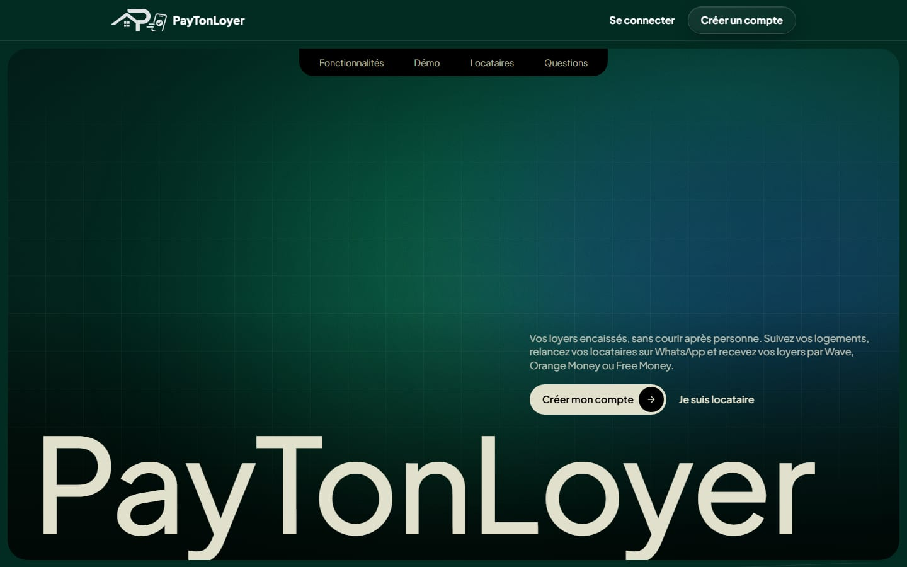
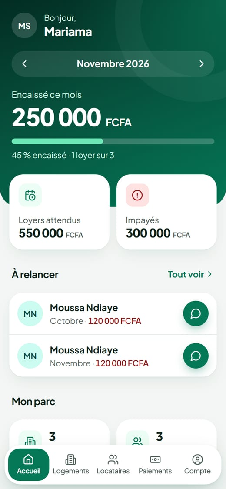
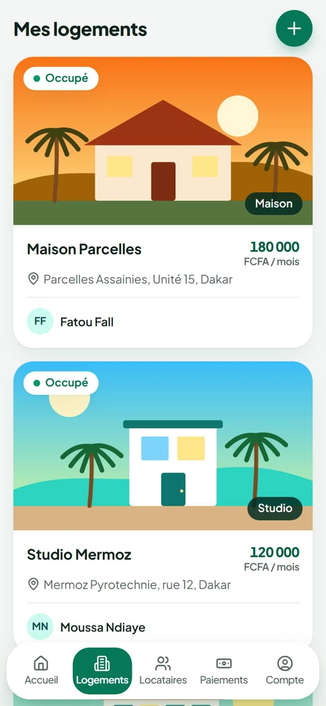
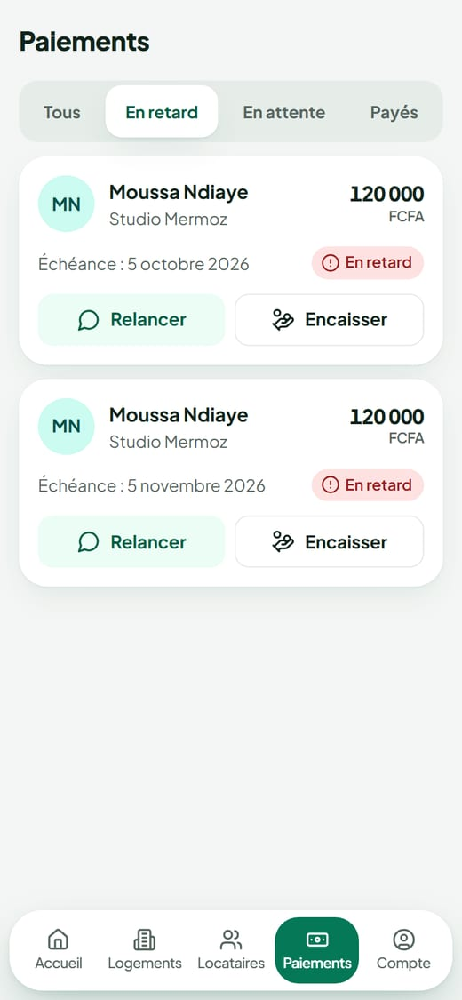
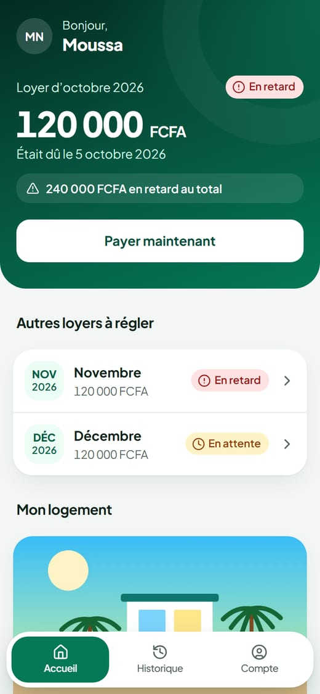
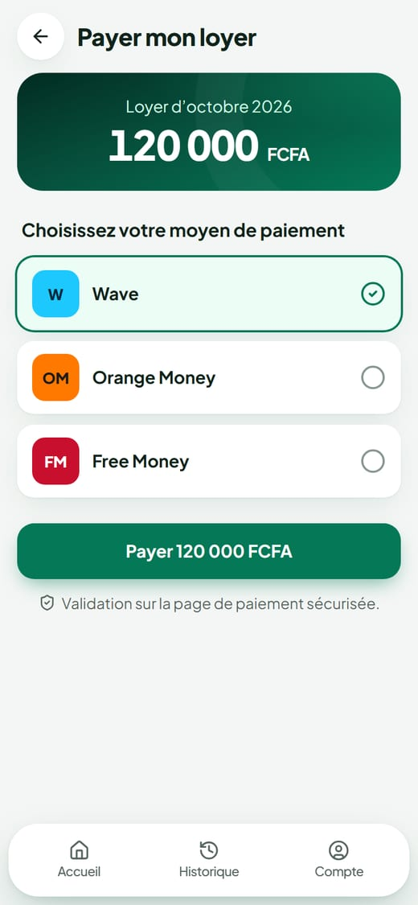
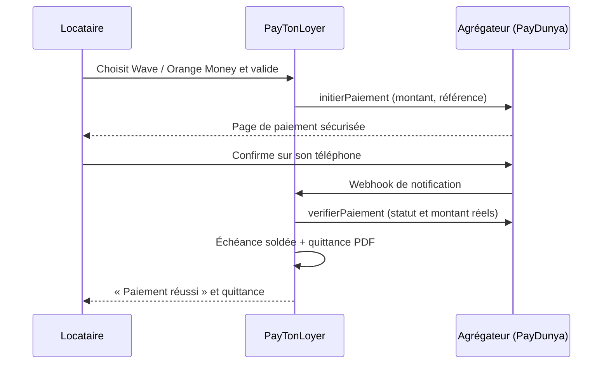
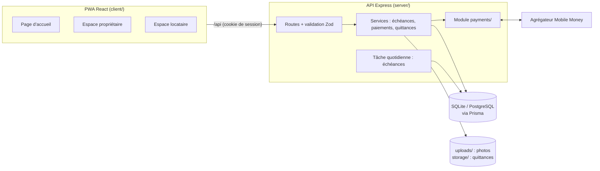

<div align="center">


### La gestion locative simple, pensée pour le Sénégal et l’Afrique de l’Ouest

Suivez vos logements, relancez vos locataires sur WhatsApp et encaissez vos loyers par Wave, Orange Money ou Free Money.
Chaque paiement génère automatiquement sa quittance.


</div>



---

## Sommaire

- [Le problème](#le-problème)
- [Aperçu](#aperçu)
- [Fonctionnalités](#fonctionnalités)
- [Démarrage rapide](#démarrage-rapide)
- [Comptes de démonstration](#comptes-de-démonstration)
- [Paiement Mobile Money](#paiement-mobile-money)
- [Configuration](#configuration)
- [Architecture](#architecture)
- [API](#api)
- [Sécurité](#sécurité)
- [Tests](#tests)
- [Mise en production](#mise-en-production)
- [Identité visuelle](#identité-visuelle)
- [Limites connues et pistes](#limites-connues-et-pistes)

---

## Le problème

Au Sénégal, la location se gère encore surtout de façon informelle : un carnet, des appels pour réclamer le loyer, des reçus écrits à la main, des échanges WhatsApp éparpillés. Résultat : des retards de paiement, aucune traçabilité et aucune vue d’ensemble sur ses logements.

PayTonLoyer réunit tout au même endroit :

| Avant | Avec PayTonLoyer |
|---|---|
| Un carnet qui finit par se perdre | Chaque paiement enregistré et retrouvable |
| Des appels pour réclamer le loyer | Un rappel WhatsApp déjà rédigé, en un geste |
| Des reçus écrits à la main | Une quittance PDF générée automatiquement |
| Le loyer à récupérer en main propre | Un paiement Wave, Orange Money ou Free Money depuis le téléphone |

---

## Aperçu

<table>
  <tr>
    <td align="center" width="33%"><br /><sub><b>Tableau de bord</b><br />Encaissé, attendu, impayé, relances</sub></td>
    <td align="center" width="33%"><br /><sub><b>Logements</b><br />Photos, loyer, statut, locataire</sub></td>
    <td align="center" width="33%"><br /><sub><b>Paiements</b><br />Relance WhatsApp ou encaissement</sub></td>
  </tr>
  <tr>
    <td align="center"><br /><sub><b>Espace locataire</b><br />Loyer dû, retards, logement</sub></td>
    <td align="center"><br /><sub><b>Paiement</b><br />Wave, Orange Money, Free Money</sub></td>
    <td align="center"><br /><sub><b>Quittance PDF</b><br />Générée à chaque paiement</sub></td>
  </tr>
</table>

---

## Fonctionnalités

### Pour le propriétaire
- **Tableau de bord du mois** : loyers attendus, encaissés et impayés, arriérés des mois précédents, locataires à relancer.
- **Logements** : création, modification, statut libre ou occupé, jusqu’à 10 photos compressées automatiquement.
- **Locataires** : ajout, affectation à un logement, changement du jour d’échéance, fin de bail.
- **Échéances automatiques** : les loyers de chaque mois sont créés sans aucune saisie ; les retards sont calculés en temps réel.
- **Suivi des paiements** par mois et par statut (payé, en attente, en retard), avec l’historique de chaque locataire.
- **Rappels WhatsApp** : un message poli, déjà rédigé, s’ouvre en un geste pour chaque loyer en retard.
- **Paiements en espèces ou par virement** enregistrés manuellement, avec leur quittance.
- **Quittances PDF** avec montant en lettres, téléchargeables à tout moment.
- **Alertes d’anomalie** : un paiement d’un montant incorrect ou reçu en double est signalé sur le tableau de bord.

### Pour le locataire
- Connexion avec son **numéro de téléphone et un code à 6 chiffres**, à personnaliser dès la première connexion.
- Loyer du mois, date d’échéance, total des retards et informations du logement.
- **Paiement par Mobile Money** depuis le téléphone, avec confirmation à l’écran.
- **Historique** des loyers et téléchargement des quittances.

### Services connectés (gratuits, sans clé)
- **Carte des logements** : l’adresse est convertie en position par [Nominatim / OpenStreetMap](https://nominatim.org/) puis affichée sur une carte. La position est estimée : à Dakar, préciser le quartier et la ville améliore le résultat. Les règles d’usage de Nominatim (1 requête par seconde, application identifiée) sont respectées. Désactivable avec `GEOCODAGE_ACTIF=non`.
- **Loyer en euros et en dollars** pour les locataires de la diaspora : euro au taux fixe officiel (1 € = 655,957 FCFA), dollar d’après le taux de la BCE via [Frankfurter](https://frankfurter.dev/). Montants indicatifs.
- **QR code de vérification** sur chaque quittance : il ouvre la page publique `/verifier/<numéro>`, qui confirme l’authenticité de la quittance en n’affichant que les initiales des personnes. Le QR code est généré localement, sans service externe.

### Côté technique
- **Application web installable (PWA)**, pensée pour les petits écrans et les connexions lentes : écrans chargés à la demande, polices hébergées dans l’application, images compressées.
- Interface entièrement en français, montants en FCFA (`150 000 FCFA`), dates au format français.
- **Accessible** : contrastes vérifiés, cibles tactiles d’au moins 44 px, navigation au clavier, animations réduites si l’appareil le demande.

---

## Démarrage rapide

**Prérequis :** [Node.js](https://nodejs.org) 20 ou plus récent.

```bash
# 1. Récupérer le projet
git clone https://github.com/BoubacarThiam/PayTonLoyer.git
cd PayTonLoyer

# 2. Installer les dépendances (racine, serveur et client)
npm run installer

# 3. Créer le fichier de configuration
cp server/.env.example server/.env        # PowerShell : Copy-Item server/.env.example server/.env
```

Dans `server/.env`, remplacez `JWT_SECRET` par une valeur aléatoire :

```bash
node -e "console.log(require('crypto').randomBytes(48).toString('hex'))"
```

```bash
# 4. Créer la base de données et charger les données de démonstration
cd server
npx prisma migrate deploy
npx prisma generate
npm run db:seed
cd ..

# 5. Lancer l’application
npm run dev
```

- Application : **<http://localhost:5173>**
- API : <http://localhost:4000>

> **Windows :** évitez de placer le projet dans un dossier synchronisé (OneDrive, Dropbox) : la synchronisation peut verrouiller la base SQLite et `node_modules`.

### Commandes utiles

| Commande (à la racine) | Rôle |
|---|---|
| `npm run dev` | Lance l’API et le site en mode développement |
| `npm test` | Lance les tests de l’API |
| `npm run build` | Compile le site pour la production |
| `npm start` | Démarre le serveur de production (API + site compilé) |
| `npm run seed` | Réinitialise les données de démonstration (bloqué en production) |

---

## Comptes de démonstration

| Rôle | Identifiant | Mot de passe / code | Situation |
|---|---|---|---|
| Propriétaire | `proprietaire@demo.sn` | `demo1234` | 3 logements, 3 locataires |
| Locataire | `77 111 11 11` | `111111` | Awa Diop, à jour |
| Locataire | `77 222 22 22` | `222222` | Moussa Ndiaye, en retard : idéal pour tester un paiement |
| Locataire | `77 333 33 33` | `333333` | Fatou Fall, paie en espèces |

---

## Paiement Mobile Money

Les paiements passent par un **agrégateur** (PayDunya), qui gère Wave, Orange Money et Free Money. Le code est isolé dans `server/payments/` derrière une interface unique :

```js
initierPaiement({ reference, montant, methode, client, urls }) // -> { referenceExterne, urlPaiement }
verifierPaiement(referenceExterne)                               // -> { statut, montant }
webhook(req)                                                     // authentifie la notification
```

Changer d’agrégateur (PayTech, CinetPay…) revient à écrire un module qui respecte cette interface et à l’ajouter dans `server/payments/index.js`.

### Parcours d’un paiement



**Règles de fiabilité :**
- Un webhook n’est **jamais cru sur parole** : statut et montant sont relus auprès de l’agrégateur.
- **Un seul paiement en cours** par échéance (contrainte en base), même en cas de double clic.
- Un webhook rejoué est ignoré ; une échéance n’a qu’une seule quittance.
- Un montant incorrect, ou un paiement reçu pour un loyer déjà réglé, devient une **anomalie** visible du propriétaire.
- Si le webhook n’arrive pas, le paiement est confirmé au retour du locataire dans l’application.

### Trois modes

| Mode | Réglage | Usage |
|---|---|---|
| **Simulateur** (par défaut) | `PAIEMENT_FOURNISSEUR=simulateur` | Démonstration et tests : une page permet de valider, faire échouer ou annuler. Refusé en production. |
| **PayDunya sandbox** | `PAIEMENT_FOURNISSEUR=paydunya`, `PAYDUNYA_MODE=test` | Paiements de test avec vos clés PayDunya. Exposez l’API par un tunnel (`ngrok http 4000`) et mettez son URL dans `API_URL` pour recevoir les webhooks. |
| **PayDunya production** | `PAYDUNYA_MODE=live` | Vraies transactions, clés de production, URLs publiques en HTTPS. |
| **SasPay** | `PAIEMENT_FOURNISSEUR=saspay`, `SASPAY_API_KEY`, `SASPAY_WEBHOOK_SECRET`, `SASPAY_EMAIL_CLIENT` | Wave (`wave_sn`), Orange Money (`orange_sn`), Free Money (`freemoney_sn`). Clé `sk_test_…` = bac à sable. Une clé `sk_live_…` est **refusée hors production**, sauf `SASPAY_AUTORISER_LIVE=oui`. Le webhook se déclare dans le tableau de bord SasPay : `https://<votre-api>/api/paiements/webhook/saspay`, événements `transaction.success`, `transaction.failed` et `transaction.cancelled`. |

Les **paiements en espèces ou par virement** sont enregistrés par le propriétaire depuis l’écran Paiements.

---

## Configuration

Toutes les variables se trouvent dans `server/.env` (modèle : [`server/.env.example`](server/.env.example)). Les clés ne sont jamais écrites dans le code.

| Variable | Rôle | Défaut |
|---|---|---|
| `NODE_ENV` | `development`, `test` ou `production` | `development` |
| `PORT` | Port de l’API | `4000` |
| `CLIENT_URL` | URL publique du site (retours de paiement) | `http://localhost:5173` |
| `API_URL` | URL publique de l’API, joignable par l’agrégateur | `http://localhost:4000` |
| `DATABASE_URL` | Base de données | `file:./dev.db` |
| `JWT_SECRET` | Secret de signature des sessions (32 caractères minimum en production) | obligatoire |
| `JWT_DUREE` | Durée d’une session | `7d` |
| `PAIEMENT_FOURNISSEUR` | `simulateur` ou `paydunya` | `simulateur` |
| `PAYDUNYA_MODE` | `test` (sandbox) ou `live` | `test` |
| `PAYDUNYA_MASTER_KEY`, `PAYDUNYA_PRIVATE_KEY`, `PAYDUNYA_PUBLIC_KEY`, `PAYDUNYA_TOKEN` | Clés de l’application PayDunya | vide |
| `PAYDUNYA_STORE_NAME` | Nom affiché sur la page de paiement | `PayTonLoyer` |
| `PAYDUNYA_CANAL_WAVE`, `…_ORANGE_MONEY`, `…_FREE_MONEY` | Limite la page de paiement à un canal précis (facultatif) | vide |

---

## Architecture



| Couche | Technologies |
|---|---|
| Client | React 19, Vite, Tailwind CSS 4, React Router, PWA (vite-plugin-pwa), GSAP et framer-motion pour la page d’accueil |
| Serveur | Node.js, Express 5, Zod, JWT (cookie `httpOnly`), bcrypt, Multer + Sharp, PDFKit, node-cron |
| Données | Prisma ORM, SQLite en local, migrable vers PostgreSQL |
| Tests | Vitest, Supertest |

### Modèle de données

| Table | Contenu |
|---|---|
| `User` | Propriétaires et locataires (rôle, téléphone unique, mot de passe haché) |
| `Logement` / `PhotoLogement` | Biens loués et leurs photos |
| `Bail` | Lien locataire ↔ logement, jour d’échéance, loyer ; garde l’historique |
| `Echeance` | Un loyer mensuel (unique par bail et par mois) |
| `Paiement` | Mobile Money, espèces ou virement, avec son statut |
| `Quittance` | Une seule par échéance |
| `EvenementWebhook` | Notifications déjà traitées (anti-doublon) |

### Structure du dépôt

```
PayTonLoyer/
├── client/                    Application web (PWA)
│   ├── public/                logo, icônes, manifeste
│   └── src/
│       ├── api/               client HTTP
│       ├── components/        composants partagés (ui.jsx, navigation…)
│       │   └── ui/            composants d’animation (motion-footer, prisma-hero)
│       ├── pages/
│       │   ├── auth/          connexion, inscription, changement de code
│       │   ├── proprietaire/  tableau de bord, logements, locataires, paiements
│       │   ├── locataire/     accueil, paiement, historique
│       │   └── vitrine/       page d’accueil publique et son animation
│       ├── hooks/ lib/ styles/ utils/
├── server/                    API
│   ├── payments/              agrégateurs de paiement (PayDunya, simulateur)
│   ├── prisma/                schéma, migrations, données de démonstration
│   ├── src/
│   │   ├── routes/            points d’entrée de l’API
│   │   ├── services/          logique métier
│   │   ├── middlewares/       authentification, rôles, validation, erreurs
│   │   ├── validators/        schémas Zod
│   │   └── jobs/              génération quotidienne des échéances
│   ├── scripts/               génération des logos et icônes
│   └── tests/
├── docs/captures/             captures d’écran de ce README
├── marque/                    logo source
├── motion/                    showreel animé (HTML + GSAP) et export vidéo
└── prototype/                 première maquette HTML, conservée pour l’historique
```

---

## API

Toutes les routes sont préfixées par `/api`. L’authentification passe par un cookie de session `httpOnly`. Les erreurs sont renvoyées en JSON avec un message en français : `{ "message": "…", "code": "…", "champs": { … } }`.

<details>
<summary><b>Voir toutes les routes</b></summary>

| Méthode | Route | Accès | Rôle |
|---|---|---|---|
| `GET` | `/sante` | public | État du serveur |
| `POST` | `/auth/inscription` | public | Créer un compte propriétaire |
| `POST` | `/auth/connexion` | public | Connexion propriétaire (e-mail ou téléphone) |
| `POST` | `/auth/connexion-locataire` | public | Connexion locataire (téléphone + code) |
| `POST` | `/auth/deconnexion` | public | Fermer la session |
| `GET` | `/auth/moi` | connecté | Utilisateur courant |
| `POST` | `/auth/changer-code` | connecté | Changer de mot de passe ou de code |
| `GET` | `/tableau-de-bord?periode=AAAA-MM` | propriétaire | Totaux du mois, arriérés, anomalies |
| `GET` `POST` | `/logements` | propriétaire | Lister, créer |
| `GET` `PUT` `DELETE` | `/logements/:id` | propriétaire | Consulter, modifier, supprimer |
| `POST` | `/logements/:id/photos` | propriétaire | Ajouter des photos |
| `DELETE` | `/logements/:id/photos/:photoId` | propriétaire | Retirer une photo |
| `GET` `POST` | `/locataires` | propriétaire | Lister, créer (renvoie un code provisoire) |
| `GET` `PUT` | `/locataires/:id` | propriétaire | Détail et historique, modifier |
| `POST` | `/locataires/:id/reinitialiser-code` | propriétaire | Nouveau code provisoire |
| `POST` | `/locataires/:id/affecter` | propriétaire | Affecter à un logement |
| `POST` | `/locataires/:id/fin-bail` | propriétaire | Mettre fin au bail |
| `GET` | `/echeances?periode=&statut=` | propriétaire | Loyers filtrés, avec lien WhatsApp si retard |
| `POST` | `/echeances/:id/paiement-manuel` | propriétaire | Enregistrer espèces ou virement |
| `GET` | `/locataire/accueil` | locataire | Logement, loyer dû, retards |
| `GET` | `/locataire/historique` | locataire | Historique des loyers |
| `GET` | `/paiements/methodes` | locataire | Moyens de paiement disponibles |
| `POST` | `/paiements/initier` | locataire | Démarrer un paiement Mobile Money |
| `GET` | `/paiements/:reference` | locataire | Statut d’un paiement |
| `POST` | `/paiements/:reference/annuler` | locataire | Annuler un paiement en cours |
| `POST` | `/paiements/webhook/:fournisseur` | agrégateur | Notification de paiement (signée) |
| `GET` | `/quittances/:id/pdf` | propriétaire ou locataire concerné | Télécharger une quittance |

</details>

---

## Sécurité

- Mots de passe et codes **hachés avec bcrypt** ; session en **JWT dans un cookie `httpOnly`**, `SameSite=Lax`, `Secure` en production.
- **Isolation des données** : chaque requête est filtrée par l’utilisateur connecté ; accéder à la ressource d’un autre renvoie 404.
- **Validation de toutes les entrées** côté serveur (Zod), avec des messages d’erreur en français.
- **Protection contre la force brute** : limitation des tentatives par adresse IP et blocage du compte 15 minutes après 5 erreurs.
- Code provisoire du locataire **à changer obligatoirement** à la première connexion.
- Photos ré-encodées par Sharp (fichiers invalides rejetés, métadonnées GPS supprimées) ; quittances servies **uniquement après contrôle d’accès**.
- En-têtes de sécurité avec Helmet ; simulateur de paiement **interdit en production**.

---

## Tests

```bash
npm test
```

50 tests (Vitest + Supertest) sur une base et des dossiers séparés :

| Domaine | Ce qui est vérifié |
|---|---|
| Authentification | Inscription, connexion, messages d’erreur, blocage après 5 essais, code provisoire |
| Isolation | Un utilisateur ne voit ni ne modifie jamais les données d’un autre |
| Photos | Compression en WebP, rejet des faux fichiers |
| Paiements | Réussite, échec, annulation, double clic, webhook rejoué ou falsifié, montant incorrect, panne de l’agrégateur |
| PayDunya | Adaptateur testé avec des réponses d’API simulées (URLs, en-têtes, statuts, signature) |

---

## Mise en production

```bash
npm run build     # compile le site dans client/dist
npm start         # le serveur sert l’API et le site sur PORT
```

Avant de mettre en ligne :

1. `NODE_ENV=production` et un `JWT_SECRET` d’au moins 32 caractères.
2. Servir l’application en **HTTPS** (sans quoi le cookie de session n’est pas envoyé).
3. Configurer PayDunya en mode `live`, avec `API_URL` et `CLIENT_URL` publiques.
4. Sauvegarder régulièrement la base, `server/uploads/` et `server/storage/quittances/`.

**Passer à PostgreSQL :** dans `server/prisma/schema.prisma`, mettez `provider = "postgresql"`, renseignez `DATABASE_URL`, supprimez `server/prisma/migrations/` puis lancez `npx prisma migrate dev --name init`.

---

## Identité visuelle

- **Logo** : la source est `marque/logo-source.png`. `node server/scripts/generer-logos.js` produit les versions bleue et blanche, l’emblème et toutes les icônes de l’application.
- **Animation de marque** : jouée en direct sur la page d’accueil (`client/src/pages/vitrine/AnimationMarque.jsx`). Sa version autonome, `motion/showreel.html`, peut être exportée en MP4 pour les réseaux sociaux :

```bash
cd motion
npm install
npm run rendre      # motion/showreel-1080p.mp4 (FFmpeg requis)
```

---

## Limites connues et pistes

**Limites actuelles**
- Chaque loyer se règle en totalité : les acomptes ne sont pas encore gérés.
- Un paiement enregistré manuellement ne peut pas être annulé depuis l’application.
- Un numéro de téléphone correspond à un seul compte.
- Le code provisoire du locataire est transmis par le propriétaire (pas d’envoi par SMS).
- Le moyen enregistré est celui choisi dans l’application, même si le locataire en change sur la page de l’agrégateur.

**Pistes d’évolution**
- Paiements partiels et échéanciers de rattrapage
- Rappels automatiques par SMS ou WhatsApp Business
- Contrats de bail et états des lieux numériques
- Tableau de bord multi-propriétaires pour les agences
- Export comptable annuel

---

<div align="center">

Conçu par **[Boubacar Thiam](https://github.com/BoubacarThiam)** · Dakar, Sénégal

</div>
